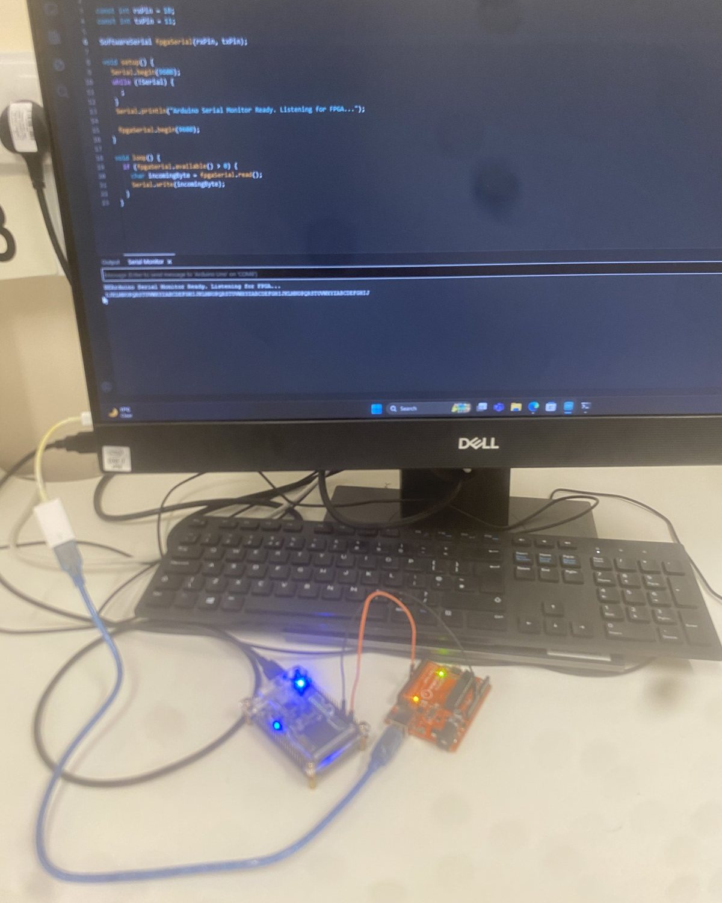
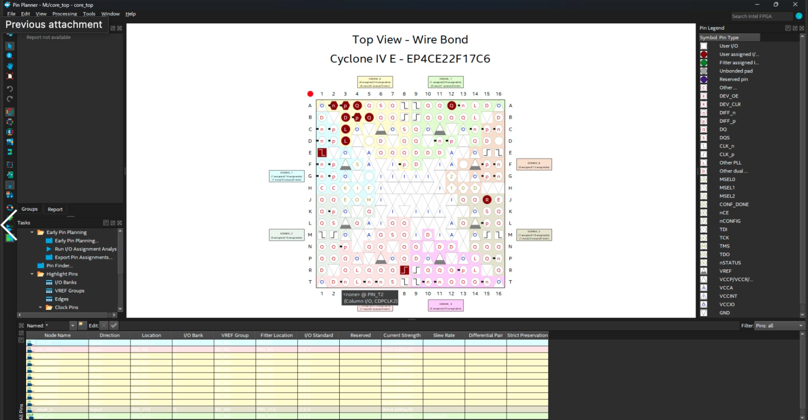
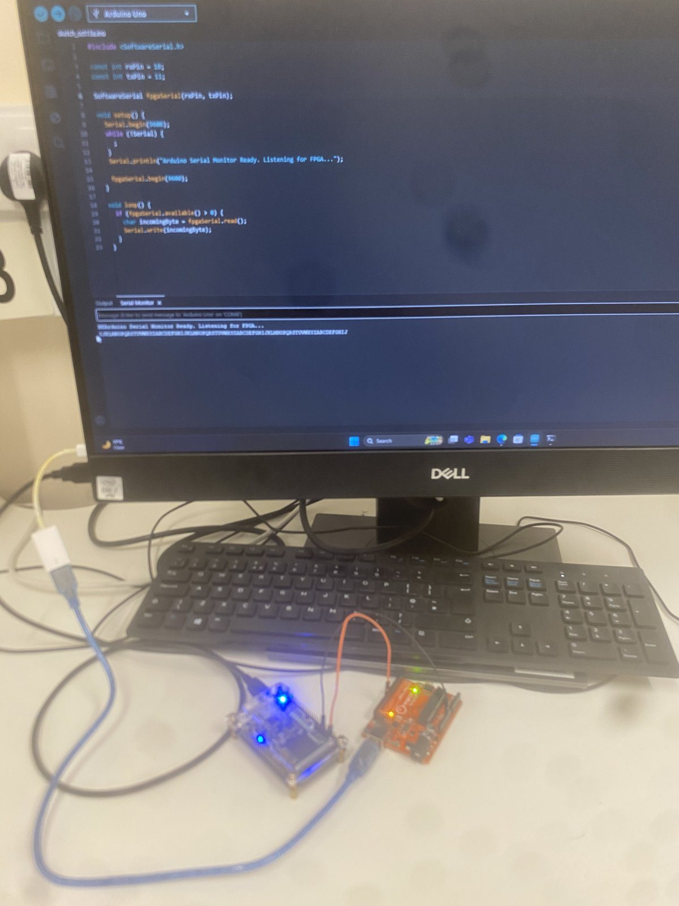
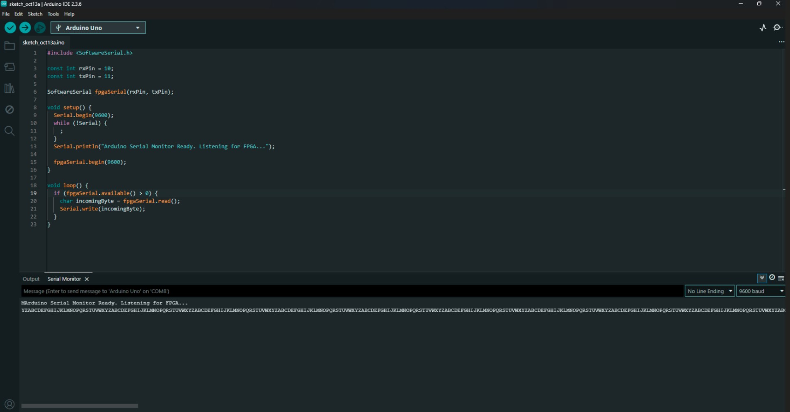

# FPGA UART Transmitter in SystemVerilog

A UART transmitter implemented without vendor IP on a Terasic DE0-Nano board and verified in hardware using an independent Arduino receiver.

[View the full interactive project page](https://zceeamt.github.io/#fpga-uart)



## Overview

The design targets the **Intel Cyclone IV E EP4CE22F17C6** FPGA. It derives 9600-baud timing from the board's 50 MHz oscillator, frames data using the UART 8N1 format and continuously transmits the ASCII characters A through Z.

The FPGA output was connected to an Arduino Uno sharing a common ground. The Arduino received the stream at 9600 baud and relayed it to a host computer, where the full character sequence arrived continuously without corruption.

## UART framing

Each character is transmitted as:

```text
idle = 1

start  data bits, least significant first     stop
  0     D0 D1 D2 D3 D4 D5 D6 D7                1
```

The transmitter uses a finite-state machine to sequence the idle, start-bit, data-bit and stop-bit periods.

## Baud-rate generation

At 50 MHz and 9600 baud:

```text
clocks per bit = 50,000,000 / 9,600 ≈ 5,208
```

A parameterised counter holds each serial bit for approximately 5,208 FPGA clock cycles. The small rounding error is below 0.01%, allowing the asynchronous transmitter and receiver to remain aligned throughout each frame.

## FPGA implementation

- Top-level module connects the RTL to the 50 MHz board clock and serial-output GPIO; reset is held inactive internally rather than assigned to an external FPGA pin.
- Baud counter generates one UART bit interval.
- State machine sequences standard 8N1 frames.
- Shift/data register presents each bit least significant first.
- Character generator advances from ASCII `A` through `Z`.
- Quartus Prime performs synthesis, fitting and device programming.
- Pin Planner maps the design onto the EP4CE22F17C6 package pins.



## Hardware verification

| Physical setup | Received output |
|---|---|
|  |  |

Testing against an independent receiver verifies the baud timing, frame structure, pin assignment and physical connection together.

## Technical summary

| Item | Specification |
|---|---|
| Development board | Terasic DE0-Nano |
| FPGA | Intel Cyclone IV E, EP4CE22F17C6 |
| HDL | SystemVerilog |
| Toolchain | Intel Quartus Prime |
| System clock | 50 MHz |
| Baud rate | 9600 |
| Frame format | 8N1, least significant bit first |
| Test receiver | Arduino Uno using SoftwareSerial |
| Result | Continuous error-free A-to-Z stream on hardware |

## Skills demonstrated

SystemVerilog, RTL design, finite-state machines, counters, clock division, UART, Quartus Prime, FPGA pin assignment and hardware-in-the-loop testing.

> The repository currently documents the implemented and tested design. The cleaned Quartus project and RTL source can be added when prepared for publication.
